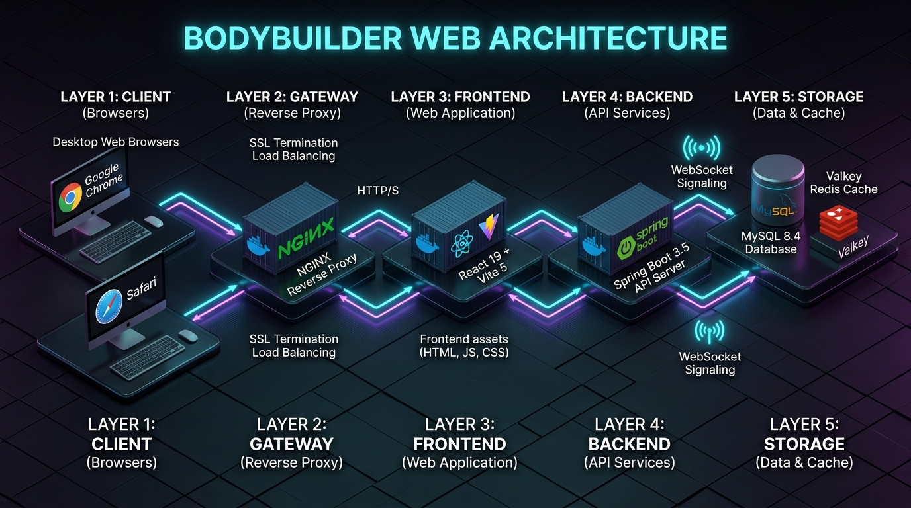

# BodyBuilder
> 몸으로 길을 잇는 협동 웹 게임

<p align="center">
  
</p>

## 1. 프로젝트 소개

### 프로젝트 개요

| 항목 | 내용 |
| --- | --- |
| 팀명 | 귀막힌청년들 (SSAFY 15기 공통 프로젝트 D203) |
| 서비스명 | BodyBuilder |
| 한 줄 소개 | 웹캠 모션 인식과 WebRTC를 활용해, 플레이어의 팔로 다리를 놓아 캐릭터를 목적지까지 보내는 협동 웹 게임 |
| 개발 기간 | 2026.07.18 ~ 2026.08.07 |
| 인원 | 6명 (Frontend 3, Backend 3) |

### 프로젝트 배경

기존의 파티 게임은 대부분 키보드와 마우스를 중심으로 진행되어, 플레이어가 몸을 직접 활용하는 재미와 몰입감을 경험하기 어렵습니다. 저희 팀은 별도의 장비 없이 **웹캠 하나만으로** 몸을 게임 컨트롤러로 바꾸고, 실시간 협업과 비언어적 소통을 통해 새로운 형태의 게임 경험을 제공하고자 했습니다.

### 서비스 한 줄 소개

위기에 빠진 생명체(오리)를 구하기 위해, 플레이어들은 서로의 몸과 움직임을 맞추며 협력해야 합니다. 각자가 카메라 앞에서 만든 **팔과 어깨의 선분이 그대로 지형이 되어**, 캐릭터가 굴러갈 하나의 다리로 이어집니다.

---

## 2. 문제 정의 및 해결 방향

### 문제 정의

- 기존 멀티플레이 게임은 입력 장치 중심이라 몸을 활용한 상호작용이 제한적입니다.
- 협동 게임에서 비언어적 커뮤니케이션과 즉각적인 반응성이 중요한데, 기존 방식은 이를 충분히 표현하지 못합니다.
- 모션 인식 게임은 대부분 전용 하드웨어를 요구해 접근성이 낮습니다.

### 해결 방향

- **MediaPipe Pose Landmarker**를 브라우저에서 직접 구동해, 웹캠만으로 어깨·팔꿈치·손목 6개 관절을 추적합니다.
- 추적한 좌표를 서버로 전송하고, 서버의 **dyn4j 물리 엔진**이 이를 지형(캡슐 선분)으로 변환해 시뮬레이션합니다. 결과 프레임을 방 전체에 브로드캐스트해 **모든 플레이어가 동일한 결과**를 보게 만듭니다.
- **WebRTC**로 서로의 얼굴과 목소리를 공유해, 자세를 맞추는 과정 자체가 협업이 되도록 설계했습니다.

---

## 3. 핵심 기능

| 기능 | 설명 |
| --- | --- |
| 모션 인식 입력 | MediaPipe Pose Landmarker(GPU delegate)로 왼손목–왼팔꿈치–왼어깨–오른어깨–오른팔꿈치–오른손목 6점을 추적 |
| 서버 권위 물리 시뮬레이션 | dyn4j 기반 서버 시뮬레이터가 포즈를 지형으로 변환해 계산, 클라이언트는 결과 프레임만 재생 |
| 실시간 화상·음성 | WebRTC Mesh P2P (STOMP 시그널링, STUN/TURN 구성 가능) |
| 방 시스템 | 방 생성/참여, 비밀번호 방, 빠른 시작, 준비 상태 동기화, 최대 4인 |
| 스테이지 & 라운드 | 스테이지당 3라운드, 라운드마다 플레이어별 3초 촬영 × 4회 |
| 맵 기믹 | `JUMP_PAD`(점프대), `WIND_ZONE`(바람), `WATER_PIPE`(물살), `KILL_ZONE`(추락 판정) |
| 연출 | 스테이지 시작·성공·실패 컷신, 스프라이트 캐릭터 애니메이션, 스테이지별 BGM |
| 기록 & 랭킹 | 스테이지/라운드 클리어 타임 기록, 스테이지별 랭킹, 마이페이지 |
| 인증 | 일반 회원가입/로그인 + Google · Kakao 소셜 로그인 (세션 쿠키 기반) |
| 운영 도구 | 관리자 로그 페이지(활성/종료 세션, 게임 이벤트, 에러 추적), 맵 에디터 |

---

## 4. 게임 플레이 흐름

```text
1. 메인 → 로그인 (일반 / Google / Kakao)
2. 방 목록에서 방 생성 · 참여 · 빠른 시작
3. 로비에서 WebRTC 연결, 스테이지 선택, 전원 READY
4. 스테이지 시작 컷신 재생
5. 라운드 진행 (스테이지당 3라운드)
     ├─ LOADING     : 맵 데이터 수신, 5초 카운트다운
     ├─ CAPTURING   : 플레이어 순서대로 3초씩 포즈 촬영 (총 4회)
     │                촬영된 좌표는 즉시 방 전체에 브로드캐스트
     ├─ SIMULATING  : 서버가 dyn4j로 최대 15초 시뮬레이션 후 프레임 전송
     └─ COMPLETED   : 도착 성공 시 다음 라운드, 실패 시 재도전
6. 스테이지 결과 (별점 · 클리어 타임) → 기록 저장 → 랭킹 반영
```

### 라운드 타이밍 상수

| 상수 | 값 |
| --- | --- |
| 촬영 시작 대기 | 5,000 ms |
| 1회 촬영 시간 | 3,000 ms |
| 응답 유예 | 1,000 ms |
| 라운드당 촬영 요청 수 | 4회 |
| 시뮬레이션 최대 시간 | 15초 (물리 스텝 1/180초) |
| 맵 좌표계 | 1000 × 1000 px |

---

## 5. 기술 스택

### Frontend

| 구분 | 사용 기술 |
| --- | --- |
| 언어 · 프레임워크 | React 19, TypeScript 6, React Router 7 |
| 빌드 | Vite 8 |
| 모션 인식 | `@mediapipe/tasks-vision` (Pose Landmarker Lite, GPU delegate) |
| 실시간 통신 | WebRTC, `@stomp/stompjs` + SockJS |
| 테스트 | Vitest, Testing Library, MSW |
| 린트 | oxlint |
| 스타일 | CSS (Container Query 기반 반응형 게임 보드) |

### Backend

| 구분 | 사용 기술 |
| --- | --- |
| 언어 · 프레임워크 | Java 21, Spring Boot 3.5.14 |
| 빌드 | Gradle 8.14 Wrapper |
| 웹 · 실시간 | Spring Web, Spring WebSocket (STOMP) |
| 물리 엔진 | dyn4j 6.0.0 |
| 데이터 | Spring Data JPA, MySQL 8.4, Flyway |
| 캐시 · 세션 스토어 | Spring Data Redis, Valkey |
| 보안 | Spring Security (세션 쿠키), Google / Kakao OAuth |
| 문서화 | springdoc-openapi (Swagger UI) |
| 테스트 | JUnit 5, Spring Security Test, H2 |

### Infra / DevOps

| 구분 | 사용 기술 |
| --- | --- |
| 컨테이너 | Docker, Docker Compose (development / production 분리) |
| 게이트웨이 | Nginx (Reverse Proxy, SSL Termination) |
| CI/CD | GitLab CI (validate → test → deploy), GitLab Runner |
| 배포 환경 | AWS EC2, Let's Encrypt |
| 형상 관리 | GitLab, Jira, Notion |

---

## 6. 시스템 아키텍처



```text
Layer 1  Client      Desktop Web Browser (Chrome / Safari)
                       ├─ MediaPipe Pose (브라우저 내 추론)
                       └─ WebRTC Mesh P2P (플레이어 간 영상·음성 직접 연결)
Layer 2  Gateway     Nginx  — SSL Termination, Reverse Proxy
Layer 3  Frontend    React 19 + Vite (정적 자산 서빙 컨테이너)
Layer 4  Backend     Spring Boot 3.5 API Server
                       ├─ REST API      : 인증 / 방 / 스테이지 / 기록 / 랭킹 / 관리자
                       ├─ STOMP WS      : 게임 메시지, 방 상태, WebRTC 시그널링
                       └─ dyn4j         : 서버 권위 물리 시뮬레이션
Layer 5  Storage     MySQL 8.4 (영속 데이터)  ·  Valkey (세션 · 게임 세션 캐시)
```

### 통신 규약

| 채널 | 경로 | 용도 |
| --- | --- | --- |
| STOMP Endpoint | `/ws-stomp` (SockJS) | 실시간 연결 진입점 |
| Publish Prefix | `/pub`, `/app` | 클라이언트 → 서버 |
| Subscribe Prefix | `/sub`, `/topic`, `/queue` | 서버 → 클라이언트 |
| 게임 메시지 | `/app/game/message` | 코드 기반 메시지 (`100` START, `102` CAPTURING, `104` SIMULATING, `106` RESULT, `107` POSE_BROADCAST …) |
| 시그널링 | `/app/signal/offer`, `/answer`, `/candidate` | WebRTC SDP · ICE 교환 |

### 주요 REST API

```text
POST   /api/v1/auth/signup | login | social
GET    /api/v1/users/me | /me/profile | /nickname/availability
POST   /api/v1/rooms | /rooms/join | /rooms/quick-start
GET    /api/v1/rooms | /rooms/{roomCode}
PATCH  /api/v1/rooms/{roomCode}/ready | /stage | /cutscenes | /return-to-lobby
GET    /api/v1/stages | /stages/{stageId} | /stages/{stageId}/rankings
GET    /api/v1/users/me/records | /me/rankings
GET    /api/v1/admin/sessions/active | /sessions/archived | /errors
```

Swagger UI: `http://localhost:8080/swagger-ui/index.html`

---

## 7. 프로젝트 구조

```text
S15P12D203/
├─ frontend/                     React 19 + Vite
│  ├─ src/
│  │  ├─ features/
│  │  │  ├─ auth/               로그인 · 소셜 인증 · 라우트 가드
│  │  │  ├─ rooms/              방 API · 방 STOMP 소켓
│  │  │  ├─ game/               게임 프로토콜 · 게임 소켓 · 슬롯/물살 계산
│  │  │  ├─ pose/               MediaPipe 훅 · 포즈 좌표 정렬 · 스켈레톤 렌더
│  │  │  ├─ webrtc/             mediaManager · peerManager · VideoGrid
│  │  │  ├─ character/          스프라이트 시트 · 액션 타임라인
│  │  │  ├─ cutscenes/          스테이지 컷신 카탈로그 · 플레이어
│  │  │  └─ records/ stages/ admin/ dev/
│  │  ├─ pages/                 main · rooms · lobby · game · ranking · mypage · admin
│  │  ├─ shared/                공통 API 클라이언트 · 훅 · 컴포넌트 · BGM
│  │  └─ mocks/                 MSW 핸들러 · 목 데이터
│  └─ maps/                     스테이지 배경 이미지
│
├─ backend/                      Spring Boot 3.5 + Gradle
│  └─ src/main/java/org/ssafy/bodybuilder/
│     ├─ common/                공통 응답 · 예외 · 보안 설정
│     ├─ domain/
│     │  ├─ auth/ user/         인증 · 사용자
│     │  ├─ room/               방 생성 · 입장 · 준비 상태
│     │  ├─ game/
│     │  │  ├─ message/         게임 메시지 타입 · 페이로드
│     │  │  ├─ websocket/       디스패처 · 퍼블리셔 · 중복 제거 · 핸들러
│     │  │  ├─ physics/dyn4j/   시뮬레이터 · 지형 · 바람 · 물살 · 볼 컨트롤러
│     │  │  ├─ service/         시작 · 촬영 스케줄러 · 포즈 제출 · 시뮬레이션
│     │  │  └─ repository/redis 게임 세션 캐시
│     │  ├─ record/ ranking/    기록 · 랭킹
│     │  └─ signaling/          WebRTC 시그널링 컨트롤러
│     ├─ global/config/websocket STOMP 설정 · 인증 인터셉터
│     └─ infra/                 OAuth 클라이언트 · 로깅 · Redis 설정
│
├─ deploy/                       Compose(dev/prod), Gateway Nginx, 배포 스크립트
├─ docs/                         개발 명세서 · 배포 런북 · 맵 에디터
│  └─ images/                    아키텍처 다이어그램
└─ .gitlab-ci.yml                MR 검증, EC2 로컬 이미지 빌드, master 자동 배포
```

---

## 8. 실행 방법

### 사전 요구사항

- Docker / Docker Compose (권장)
- 또는 개별 실행 시: Node.js 22+, JDK 21, MySQL 8.4, Valkey(Redis)
- **웹캠**과 카메라 권한이 필요합니다. (HTTPS 또는 `localhost`에서만 동작)

### 전체 스택 실행 (권장)

```bash
docker compose -f deploy/compose.development.yaml up -d --build
```

| 서비스 | 주소 |
| --- | --- |
| Frontend | http://localhost:5173 |
| Backend | http://localhost:18080 |
| MySQL | 127.0.0.1:13306 |
| Valkey | 127.0.0.1:16379 |

포트나 로컬 비밀번호를 바꾸려면 예시 파일을 복사해 사용합니다.

```bash
cp deploy/dev.env.example deploy/.env.dev
docker compose --env-file deploy/.env.dev \
  -f deploy/compose.development.yaml up -d --build
```

개발 데이터는 `mysql_dev_data`, `valkey_dev_data` 볼륨에 보존됩니다. 컨테이너만 종료할 때는 `down`, 데이터까지 초기화할 때만 `down -v`를 사용합니다.

```bash
docker compose -f deploy/compose.development.yaml down
```

### 개별 실행

**Frontend**

```bash
cd frontend
cp .env.example .env.local     # API URL · 소셜 키 · TURN 설정
npm install
npm run dev                    # http://localhost:5173
npm run lint                   # oxlint
npm test                       # vitest
```

> `VITE_ENABLE_MSW=true`로 두면 실제 서버 없이 MSW 목 데이터로 개발할 수 있습니다.
> 테스트 계정: 닉네임 `syncup` / 비밀번호 `password123`

**Backend**

```bash
cd backend
./gradlew bootRun              # Windows: .\gradlew.bat bootRun
./gradlew test                 # 테스트 (H2 인메모리)
```

필요 환경변수는 [`backend/README.md`](backend/README.md)를 참고하세요. 프로필을 지정하지 않으면 `dev`가 활성화되고, 운영 Compose는 `SPRING_PROFILES_ACTIVE=prod`를 명시합니다.

### 주요 환경변수

| 변수 | 위치 | 설명 |
| --- | --- | --- |
| `VITE_API_BASE_URL` | frontend | API 서버 주소 |
| `VITE_WS_BASE_URL` | frontend | STOMP 호스트 (생략 시 API URL 사용, 경로는 `/ws-stomp` 고정) |
| `VITE_ENABLE_MSW` | frontend | MSW 목 데이터 사용 여부 |
| `VITE_GOOGLE_CLIENT_ID` / `VITE_KAKAO_REST_API_KEY` | frontend | 소셜 로그인 키 |
| `VITE_TURN_URLS` / `_USERNAME` / `_CREDENTIAL` | frontend | TURN 서버 (미설정 시 Google STUN만 사용) |
| `MYSQL_URL` / `MYSQL_USER` / `MYSQL_PASSWORD` | backend | MySQL 접속 정보 |
| `VALKEY_HOST` / `VALKEY_HOST_PORT` / `VALKEY_PASSWORD` | backend | Valkey 접속 정보 |
| `CORS_ALLOWED_ORIGIN` | backend | 허용할 프론트엔드 Origin |
| `SESSION_COOKIE_SECURE` | backend | HTTPS 전용 세션 쿠키 여부 |

---

## 9. 배포

master 브랜치에 머지되면 GitLab CI가 다음 순서로 동작합니다.

```text
validate  →  compose config 검증, nginx 설정 검증, 배포 스크립트 문법 검사
test      →  frontend: npm ci → lint → build
             backend : gradlew clean test bootJar
deploy    →  EC2에서 frontend/backend 이미지 로컬 빌드 후 deploy/scripts/deploy.sh 실행
```

배포 절차와 장애 대응은 [`docs/deployment.md`](docs/deployment.md), HTTPS 적용은 [`docs/https-deployment-runbook.md`](docs/https-deployment-runbook.md)를 참고하세요.

---

## 10. 팀 소개

### 귀막힌청년들

| 백화진 | 김승제 | 김시후 | 백성수 | 이진욱 | 최준혁 |
| :---: | :---: | :---: | :---: | :---: | :---: |
| 팀장 | 팀원 | 팀원 | 팀원 | 팀원 | 팀원 |
| Backend | Backend, Infra | Frontend | Frontend (Leader) | Backend | Frontend |

각자 다른 환경에서 자라왔지만, 즐거움과 게임에는 의견이 일치했습니다. 결과와 상관없이 함께 만들며 즐기는 과정 자체를 중요하게 생각했습니다.

---

## 11. 기대 효과

- 별도 장비 없이 웹캠만으로 몸을 활용하는 새로운 협동 게임 경험 제공
- 자세를 맞추는 과정에서 자연스럽게 발생하는 비언어적 소통과 협업의 즐거움
- 설치 없이 브라우저에서 바로 즐길 수 있는 높은 접근성
- 서버 권위 물리 시뮬레이션과 브라우저 온디바이스 추론을 결합한 기술적 완성도

---

## 12. 시연 자료 및 참고 링크

| 항목 | 링크 |
| --- | --- |
| 데모 영상 | 추후 업로드 예정 |
| 발표 자료 | 추후 첨부 예정 |
| Notion | 추후 추가 예정 |
| GitLab | https://lab.ssafy.com/s15-webmobile1-sub2/S15P12D203 |
